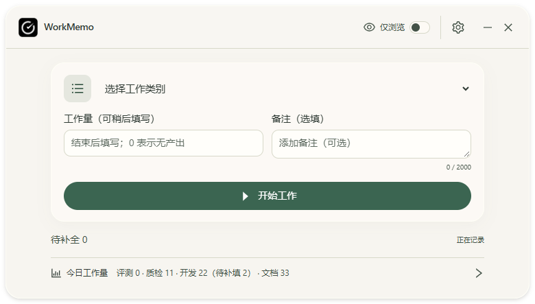
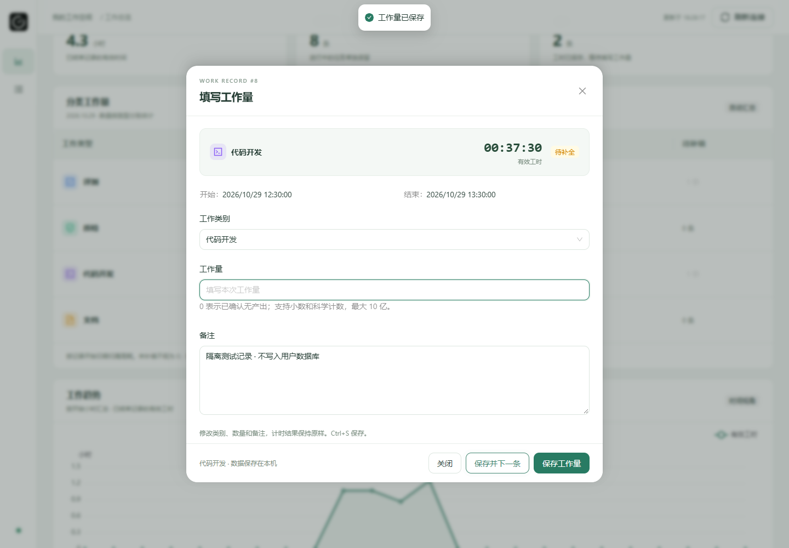

# v0.2.5 反馈修正：连续补填、居中面板与主窗口高度

日期：2026-10-30（Asia/Shanghai）。本轮为源码反馈修正，不进入正式打包发布；普通下载仍为 v0.2.4。

## 目标与检查

用户反馈：网页分类工作量的待补填「x 条」应可直接填写，并可处理下一条；详情／补填二级面板应水平垂直居中；桌面新建与工作中页面下方空白过大。

从 edd6e488113e3fba021368216bf51aab75b11745 继续，阅读 PRODUCT-SPEC.md、AGENTS.md 和现有交付记录，检查实际前端、窗口、报表 API、启动状态及 Git。开始时没有 WorkMemo 进程；工作区只有原有未跟踪 DYNAMIC-ISLAND-PLAN.md。原因分别是待补填为静态 Tag、Drawer 固定距底部、主区填满窗口且底栏使用 auto 外边距。

## 修正行为与接口

- 桌面表格和手机分类视图中的正数待补填数量改为可点击入口；0 条保持文字，不提供无效按钮。点击后直接打开该分类的第一条待补填表单。
- 使用当前已应用的周期、日期、分类与真实／演示范围；冻结已解析的周期锚点，防止跨日后下一条漂移到其他日期。未应用的筛选草稿不影响当前报表入口。
- 连续补填复用现有 POST /api/query、/api/detail、/api/save。下一条查询始终读取当前范围的 pending 第 1 页，成功结算的记录自然退出列表，避免删除已处理项后按页码递增而漏项；不新增队列数据库或业务接口。
- 编辑时提供「保存并下一条」；单独保存后可点「下一条」。保存失败／冲突不前进且保留输入；重复提交被现有忙碌锁拦截。修改本条类别后，连续补填仍沿最初选中的分类范围继续。
- 写入成功而后续读取失败时明确提示当前已保存，可以重试读取下一条，不重复保存已写入记录；下一条加载后更新焦点。全部处理后保留最后一条已保存详情并说明本范围已补填完毕。
- 详情和补填继续复用 Ant Design Drawer，保留官方进出动画、内容滚动、背景锁定、焦点保护、确认与减少动态效果；通过四边约束和 auto 外边距实现水平／垂直居中。窄屏四周保留 12px，四角统一为 20px；原确认 Modal 保持居中。
- 桌面主区使用自然高度，底栏紧随正文。新增 useMainContentHeight，在首次真实快照就绪及内容／字号／宽度发生变化后测量高度；计时器每秒刷新但高度不变时不重复申请调整。
- 新增仅允许 main 窗口调用的 fit_main_content(height) Rust IPC，校验有限数与边界，保留当前实际宽度；按舒展／紧凑最小高度和显示器工作区限高，必要时校正纵向屏幕边界，内容过长时沿原滚动区访问。未增加前端原生窗口权限，不修改计时、任务或 SQLite。
- 没有修改状态岛主体／动画、启动设置、现有数据模型、正式应用标识、数据路径或 schema 9。

## 检查结果

- Node 49 项通过；Rust 142 项库、2 项 helper、2 项原生主机、1 项注册集成，共 147 项通过。新增高度计算测试覆盖舒展／紧凑下限、短屏、向上取整、NaN／无穷和超界输入。
- TypeScript／Vite 生产构建通过；新增内容高度命令的独立 Windows debug 程序构建通过，标识仍为 com.workmemo.test.v025。源码版本号暂保留 0.2.4，等待成品阶段统一。
- 原完整网页回归通过，涵盖保存中背景不闪动、零值／科学计数、校验、冲突、写后读取失败、去重、未保存保护、周期／范围、分页、删除、滚动及焦点；390～1920px 六档宽度、短屏、125%／150% 缩放与减少动态效果下均检查居中。
- 新增网页 4 组隔离回归通过：数量直接进入表单；空值、冲突和重复提交；修改类别后仍留在原连续范围；写后读取失败及不重复保存；手机居中；53 条连续补填跨越 50 条分页界限；日期外、演示和进行中记录不被补填；0 值数量不可点击、过期正数不打开空表单。
- 桌面回归由 9 组扩展为 10 组，原四皮肤×两种密度×三档宽度的 24 组布局、状态岛和业务交互继续通过。新增模拟原生尺寸响应检查：780px 宽度不变，新建请求高度 443px、工作中 423px；卡片到底栏间距和窗口底部间距均小于 36px。
- 网页和桌面新回归均实际执行开发资源与生产资源检查；生产网页完整回归匹配本机服务 CSP。未新增运行依赖。网页图表块仍约 1510.41kB（gzip 490.25kB），保留构建的大块资源提示。
- 全部业务浏览器检查使用独立 HTTP／IPC 夹具；没有读取或修改用户工作数据库，没有为测试结束、删除或暂停用户任务。

本轮图片是隔离夹具的浏览器渲染；桌面缩高截图是按照前端请求高度设置浏览器 viewport 后得到，不能称为 Windows 原生尺寸验收。原生透明、区域点击、实际主窗口自动收高、焦点和多屏 DPI 的本轮端到端操作仍需用户实看；此前 Esc 中断的原生检查不被计为本轮通过。正式安装器／ZIP 未更新。

## 预览与完整文件

以下截图中的数量、任务和时长均为测试数据，与真实工作记录无关。






[完整 NEW FILE／UPDATE 路径清单](FIX-0.2.5-FEEDBACK-FILES.md)；[本轮所有程序与测试完整源码](FIX-0.2.5-FEEDBACK-SOURCE.md)。原源码文件是权威内容，源码汇编逐段核对，不用省略号代替代码。旧阶段记录和截图保留。

## PowerShell 检查、方法与预期

```powershell
Set-Location E:\WorkMemo
npm.cmd test
npm.cmd run build
cargo fmt --manifest-path src-tauri/Cargo.toml -- --check
cargo test --locked --manifest-path src-tauri/Cargo.toml
```

预期 Node 49、Rust 147 项通过，生产构建成功。无需迁移数据库或安装新依赖。

分别在终端启动 `npm.cmd run dev -- --host 127.0.0.1` 和 `npm.cmd run preview -- --host 127.0.0.1 --port 1422 --strictPort` 后：

```powershell
$env:WORKMEMO_PLAYWRIGHT = 'C:\Users\Administrator\.cache\codex-runtimes\codex-primary-runtime\dependencies\node\node_modules\playwright\index.mjs'
node scripts/verify-web-ui.mjs
node scripts/verify-v025-followup.mjs
node scripts/verify-v025.mjs
$env:WORKMEMO_WEB_URL = 'http://127.0.0.1:1422'
$env:WORKMEMO_UI_URL = 'http://127.0.0.1:1422/'
node scripts/verify-web-ui.mjs
node scripts/verify-v025-followup.mjs
node scripts/verify-v025.mjs
Remove-Item Env:WORKMEMO_WEB_URL
Remove-Item Env:WORKMEMO_UI_URL
```

预期原网页完整检查成功，新增网页输出 4 组并通过 53 条连续补填；桌面输出 10 组／24 组布局，高度测量记录见 artifacts/0.2.5/qa/ui-result.json。其他电脑替换 Playwright 路径。夹具会拦截所有业务请求，不连接正式数据。

手动验收时，在隔离预览中选类别开始工作，检查当前宽度不变、下方空白收紧；新建、暂停、切换、错误提示、字号变化及短屏仍能访问全部操作。再从网页分类的待补填数量进入，填写并点保存并下一条，验证最后一条完成提示、失败不跳转、任意日期／范围不混入其他记录。不要通过结束用户正在使用的任务制造待补填数据。

本机隔离构建命令为：

```powershell
npm.cmd run tauri -- build --debug --no-bundle --config E:/WorkMemo/artifacts/0.2.5/qa/native-preview.json
```

该本地配置为 com.workmemo.test.v025，不提交 Git；标准隔离构建配置可参考已跟踪的 src-tauri/tauri.preview.conf.json。运行前确认应用标识和数据目录独立，程序目录不放正式浏览器 helper。构建本身不启动、终止或处理任务。

## 兼容与 Git

继续使用 Windows 10／11 x64、WebView2 与原固定技术栈。仅增加主窗口内容高度 IPC，不修改现有业务 HTTP／IPC 形状。窗口仍可手动缩放；自然内容变化时重新拟合高度，超过屏幕工作区则保留滚动。布局设置和工作记录分开保存。

按既有授权检查暂存区后提交、推送 main；不提交 artifacts、target、依赖、本地数据库、凭据或原有未跟踪规划。推送前 fetch 并检查进展，禁止强推；推送后核对本地、origin/main 和远程提交。

```powershell
git diff --cached --check
git diff --cached --name-status
git commit -m "fix: streamline pending settlement and center compact desktop layouts"
git fetch origin
git rev-list --left-right --count HEAD...origin/main
git push origin main
git rev-parse HEAD
git ls-remote origin refs/heads/main
git status --short
```

本次反馈修正结束后总结，等待用户确认，不自动进入正式成品发布。
