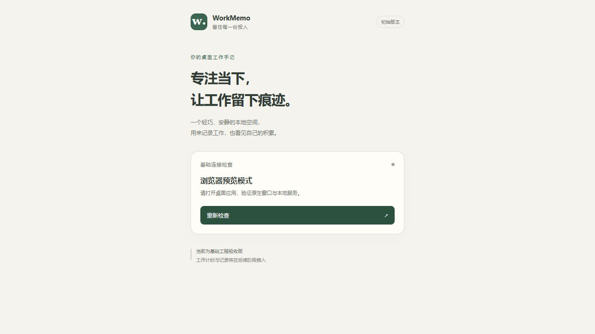

# WorkMemo 第一阶段交付记录

日期：2026-10-26（Asia/Shanghai）。阶段范围：从空目录建立最小可运行的 Windows 桌面工程，并验证前后端连接与基础构建。

## 1. 检查结果与实施范围

初始 E:\WorkMemo 为空，未发现现有源码、数据库或 Git 仓库。Node/npm 已存在，WebView2 已存在。补齐了 Rust stable MSVC、rustfmt、Visual Studio 2022 C++ Build Tools 与推荐组件。C++ 安装返回 3010，表示建议重启；没有自动重启电脑。

使用官方 create-tauri-app 的 React TypeScript 模板初始化 Tauri 2 工程，再做最小改动。删除示例问候、外链打开插件与前端模板图片；当前只有真实的 app_info 只读命令。没有创建数据库，没有伪造计时、历史、换肤或统计。

前端通过 invoke 调用 Rust，只有收到真实响应才显示「桌面连接正常」。浏览器预览、检查中、失败分别显示对应提示；失败可展开详情。按钮实际重新调用 Rust。当前保留 Windows 系统标题栏和不透明背景，透明与无边框属于后续阶段。

## 2. 完整代码与文件关系

完整的源码和配置逐文件保存在 PHASE-1-SOURCE.md，不截断代码。产品规范完整保存在 PRODUCT-SPEC.md。自动生成的完整依赖锁文件分别保存在 E:\WorkMemo\package-lock.json 和 E:\WorkMemo\src-tauri\Cargo.lock。

React 的 src/App.tsx 通过 @tauri-apps/api 调用 app_info；Rust 的 src-tauri/src/lib.rs 注册并响应此命令。src/main.tsx 挂载界面，App.css 控制页面样式。tauri.conf.json 控制原生窗口、构建、安全策略，capabilities/default.json 不申请额外原生权限。README.md 提供启动和构建方式，AGENTS.md 引用完整规范以约束后续阶段。

由于项目从空目录创建，第一阶段交付文件相对用户原始目录均为 NEW FILE。完整绝对路径逐项列于 [PHASE-1-FILES.md](PHASE-1-FILES.md)。模板内的替换已体现在最终文件中。

本次续验收的文件变更：UPDATE E:\WorkMemo\docs\PHASE-1.md；NEW FILE E:\WorkMemo\docs\PHASE-1-FILES.md；NEW FILE E:\WorkMemo\docs\phase-1-browser-preview.png。没有修改业务源码或增加依赖。

## 3. 已执行与待执行的检查

- npm install：通过；安装时 npm 审计为 0 个已知漏洞。
- npm run build：通过 TypeScript 检查及 Vite 生产构建。
- cargo generate-lockfile / cargo fetch --locked：通过。
- cargo fmt --manifest-path .\src-tauri\Cargo.toml -- --check：通过。
- Tauri 环境诊断：识别 WebView2、MSVC、Rust MSVC 工具链。
- 原生开发编译与启动：通过；窗口可访问性文本显示「桌面连接正常」及「WorkMemo 0.1.0 · 已连接本地 Rust 服务」。
- 普通浏览器预览及点击「重新检查」：通过；仍显示「浏览器预览模式」，没有误报原生服务成功。
- 原生窗口截图：未通过工具验收。截图接口报告 `FrameArrived timed out: timed out waiting on channel`；恢复窗口后仍不能截图。
- 原生鼠标、键盘与拖动交互：待人工验收。鼠标接口缺少坐标映射，键盘焦点未进入内容区；Alt+F4 没有可确认的关闭结果，不能据此判断应用关闭功能有问题或已通过。
- 开发服务清理：已停止本项目的 Tauri dev、Vite 和 debug 程序进程；系统 TCP 监听列表确认 1420 端口无监听。此操作是测试清理，不计作正常关闭测试。
- Release 构建：通过，`npm run tauri build -- --no-bundle` 返回 0，首次优化构建耗时 6 分 49 秒。
- Release 产物：E:\WorkMemo\src-tauri\target\release\workmemo.exe，4,231,680 字节（约 4.04 MiB）。SHA256：73F6C07688D3489797CE22EB58193D7CB07ABDD0891B675F1215C91AF1D452DA。
- Release 独立启动：未完成验收。启动前再次确认 1420 端口没有 TCP 监听；桌面启动工具随后报告用户按物理 Escape 停止操作，因此没有取得 Release 窗口状态，不能宣称独立启动或重新打开已通过。
- 文档完整性：PHASE-1-SOURCE.md 已逐一比对，包含的 19 份源码及配置与项目文件完整一致。

浏览器预览截图仅用于证明浏览器页面状态，不是原生窗口截图，也不证明原生透明效果：



## 4. PowerShell 使用命令

安装完成后建议重新打开 PowerShell，加载 Rust 的 PATH。若当前终端未刷新，可仅为当前终端执行：

```powershell
$env:Path = (Join-Path $env:USERPROFILE '.cargo\bin') + ';' + $env:Path
Set-Location 'E:\WorkMemo'
npm ci
npm run tauri dev
```

构建和检查：

```powershell
Set-Location 'E:\WorkMemo'
npm run build
cargo fmt --manifest-path .\src-tauri\Cargo.toml -- --check
npm run tauri info
npm run tauri build -- --no-bundle
```

已生成的 Release 可执行文件：E:\WorkMemo\src-tauri\target\release\workmemo.exe。--no-bundle 只构建可执行文件，不代表安装包或独立启动已验收。

手动启动正式程序：

```powershell
& 'E:\WorkMemo\src-tauri\target\release\workmemo.exe'
```

## 5. 逐步测试与预期

1. 运行 npm run tauri dev，出现标题为 WorkMemo 的原生窗口。
2. 页面应显示「桌面连接正常」和 WorkMemo 0.1.0，说明真实 Rust 调用成功。
3. 点击「重新检查」，检查完成后仍显示连接正常，按钮恢复可用。
4. 拖动系统标题栏，窗口能移动；拖动边缘缩放，内容可访问且不出现横向遮挡。
5. 点击系统关闭按钮，窗口关闭，开发进程退出。
6. 执行 Release 构建，再独立打开 workmemo.exe，不依赖 Vite 服务即可显示连接正常。
7. 关闭后重新打开，连接检查仍可正常执行。当前没有业务数据，不能据此宣称数据恢复已通过。
8. 仅用 npm run dev 在普通浏览器预览，应显示「浏览器预览模式」，不能显示虚假的桌面连接成功。

故障反馈路径已实现，但本阶段不通过篡改系统或原生权限人为制造服务故障。未实际执行的步骤不能视为通过。

## 6. 兼容性与待办

本阶段针对本机 Windows 10 x64 验证。其他 Windows 版本、DPI、多屏和系统缩放尚待后续验收。依赖由两个锁文件固定，建议 npm ci，避免未经评估升级。C++ 安装建议重启；当前是否可用由实际编译和启动结果判定。安装包、签名、SQLite、计时、透明、四种皮肤、历史和统计尚未验收。

环境与初始化依据：
- https://v2.tauri.app/start/prerequisites/
- https://v2.tauri.app/start/create-project/
- https://learn.microsoft.com/en-us/visualstudio/install/use-command-line-parameters-to-install-visual-studio?view=vs-2022

## 7. Git

已初始化本地 main 分支。用户随后提供了 GitHub 仓库 `https://github.com/noharass/WorkMemo` 和提交身份，并授权后续每个完成步骤提交、推送。同步规则见 AGENTS.md，操作与核验方法见 GITHUB-SYNC.md；同步不代表待验收功能已通过。

```powershell
Set-Location 'E:\WorkMemo'
git add .
git diff --cached --check
git commit -m "chore: initialize WorkMemo desktop foundation"
```

Git 身份仅配置在当前项目中，不修改全局 Git 身份。源码同步不上传依赖目录或构建产物。

## 8. 下一阶段（等待用户确认）

第一阶段当前结果：源码、依赖与 Release 构建已交付；原生开发窗口的 Rust 连接已验证。仍需手动核验 Release 独立启动、重新打开、按钮、移动、缩放、正常关闭和原生视觉布局，不能将这些项目视为通过。用户确认后再进入第二阶段。

第二阶段建议首先设计 SQLite 表结构、迁移、单活动任务约束和可靠计时状态机，再完成开始、暂停、继续、结束和异常恢复，并做对应业务测试。原生透明、主题和历史统计随后分阶段实现，不自动跨阶段。
