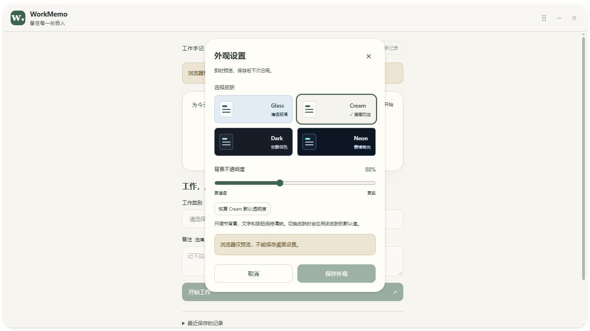
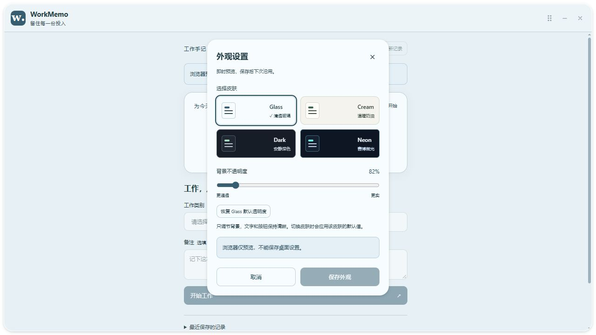
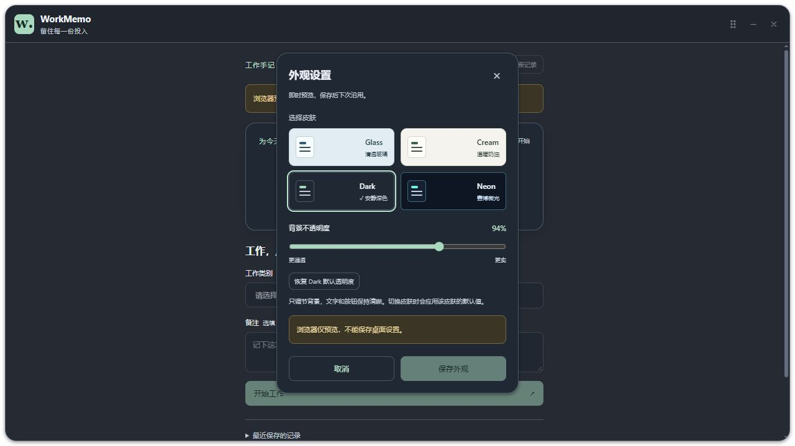
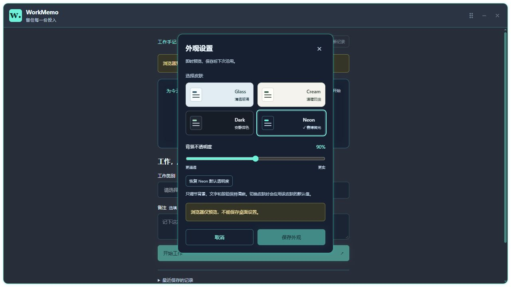

# WorkMemo 第四阶段：四种皮肤与外观持久化

日期：2026-10-26（Asia/Shanghai）。范围已获用户确认；完成后等待下一阶段确认。

## 1. 目标与现有工程检查

起点 14ee114，main 与 origin/main 一致，工作区干净。检查 React、Rust、Tauri 原生窗口配置、权限和现有数据服务；基线前端构建通过。原工程已支持原生透明、窗口控制和 SQLite 任务，但只有固定暖色背景，没有皮肤或外观配置。

开始时正式版运行中，用户确认已保存并关闭，随后才启动新的开发版。没有强制结束用户任务，没有改动工作记录结构、迁移、计时或恢复业务代码。

最小方案：统一设计令牌、独立外观控制 Hook 和设置面板；Rust 提供固定配置路径的类型化加载/保存命令；只增加 serde_json 直接依赖，该库本已存在于依赖锁中，没有升级或新增前端依赖。

## 2. 皮肤和交互

| 皮肤 | 风格 | 默认背景不透明度 |
| --- | --- | --- |
| Glass | 冷色清透、柔和高光 | 82% |
| Cream | 暖奶油、绿色强调、柔和圆角 | 88% |
| Dark | 深灰、浅绿强调、安静层次 | 94% |
| Neon | 深蓝、青色微光、较小圆角、等宽计时器 | 90% |

src/themes.ts 中的每种皮肤都提供完整令牌：窗口/面板/输入背景、文字、次要文字、强调色、按钮悬停与前景色、边框、圆角、阴影、计时器样式、关闭按钮、滚动条、警告和错误提示。CSS 统一引用令牌，不把配色散落到各业务组件。

- 外观入口位于刷新按钮旁；设置为原生 HTML dialog，焦点限制在面板内。
- 点击皮肤立即预览，并采用该皮肤默认透明度；滑块在 80%–100% 间逐整数调整。范围以不同桌面背景下的可读性为依据，只调整窗口和面板背景，文字和可用控件不整体变淡。
- 「恢复默认透明度」只改变当前预览；「保存外观」等待真实 Rust 成功响应后关闭面板并显示保存提示。
- 取消、右上角关闭及 Escape 会撤销未保存预览并回到上次保存外观，焦点回到入口。保存期间禁用修改和取消，避免异步操作产生错乱。
- 保存失败保留当前预览及错误信息，可重试，不显示虚假的保存成功。
- 原配置读取失败时保留业务界面，显示错误及重新读取入口；默认外观只是临时回退，不覆盖磁盘配置。
- 浏览器可以预览，但保存按钮禁用并明确说明不能保存桌面设置；没有第二套 localStorage 持久化。
- 主题变化只更新 DesktopWindow 的 CSS 变量，不更换组件 key，不重新挂载任务 Hook，不触发任务开始、暂停或结束命令。

## 3. 独立存储与错误处理

外观路径：`%APPDATA%\com.workmemo.desktop\appearance.json`。工作数据库仍位于 `%LOCALAPPDATA%\com.workmemo.desktop\workmemo.sqlite3`，两者分开管理，不上传 Git。

```json
{
  "version": 1,
  "theme": "cream",
  "opacity": 88
}
```

Rust 限制皮肤为 4 个枚举、opacity 为 80–100 的整数、版本为 1、配置读取最多 64 KiB。首次缺文件使用默认值，不静默创建或覆盖文件。

保存先写同目录唯一临时文件，write_all + sync_all 后关闭文件，再用 [std::fs::rename](https://doc.rust-lang.org/std/fs/fn.rename.html) 替换；不先截断旧文件，失败会清理临时文件并保留旧配置。该策略降低写一半配置的风险，不承诺真实断电下的绝对持久性。

损坏配置读取会报错；用户明确保存新外观时，先把原始字节写入独立 recovery 备份再修复。遇到较新版本配置拒绝覆盖。超大配置、权限和替换错误都明确失败。

Tauri 使用独立 AppearanceState 和 Mutex 串行化外观操作，文件 IO 在 spawn_blocking 中执行；不复用业务数据库锁，不让保存外观阻塞任务计时检查点。命令只接受外观字段，不接受任意文件路径。没有增加文件系统、Shell 或通用 SQL 权限，窗口能力配置保持不变。

## 4. 文件与完整源码

完整绝对路径及 NEW FILE / UPDATE 标记见 PHASE-4-FILES.md；全部变更源码、配置与开发说明的完整内容见 PHASE-4-SOURCE.md。Cargo.lock 的完整文件保留在原路径。

关系：themes.ts 定义皮肤，useAppearance.ts 管理读取、预览、撤销和保存，AppearanceSettings.tsx 实现面板，App.tsx 组合入口，DesktopWindow.tsx 接受根层变量。appearance.rs 管理文件与 Tauri 命令，lib.rs 只新增外观服务注册。工作数据库和计时模块未修改。

## 5. 实际验证

- TypeScript + Vite 生产构建通过。
- Rust 格式检查通过。
- Rust 23 项测试通过，0 失败：保留原 15 项业务回归，增加 8 项外观测试，覆盖缺文件、四皮肤和边界值往返、非法范围、损坏备份修复、较新版本保护、未知皮肤/超大文件、Windows 替换失败保留原文件及清理临时文件、修改外观不改变运行中工作记录。
- Node 内置测试 6 项通过，0 失败：四种皮肤的主要文字在黑白背景及不透明度边界上的对比度数值检查（至少 4.5），按钮/提示颜色检查，非法前端配置校验及令牌集合完整性。这是指定令牌组合检查，不是整套应用的可访问性认证。
- 浏览器交互实测：四种皮肤切换、80%/100% 边界、恢复默认、取消还原、Escape 还原及焦点回到入口通过；保存按钮在浏览器中禁用。四份截图仅为浏览器预览，不证明原生透明或本地保存。
- 用户在原生桌面中人工确认「都正常，已保存喜欢的外观」，问题包含四种皮肤、滑块、保存与任务/记录保持。
- 只读检查实际独立配置文件，确认保存为 Dark、94%；用户随后确认保存关闭，进程检查确认应用退出，关闭后该文件仍存在且内容保持。
- Release 构建通过，耗时 2 分 15 秒，最终可执行文件为 E:\WorkMemo\src-tauri\target\release\workmemo.exe，6,104,576 字节（约 5.82 MiB）。SHA256：C60936C88B85A0C3541A5836C3FACE40DEE57D7FA24FBD447D836F939811FD84。
- 开发服务清理后确认 1420 端口无监听；尝试重新打开正式版时，桌面工具报告用户按物理 Escape 停止操作，已停止进一步桌面输入。因此本轮未取得正式版重新打开后的界面状态，不能宣称实际重开显示已通过。文件级保存/重读测试及关闭后配置保留已通过。
- 本轮原生工具遇到窗口已最小化及激活失败；没有把浏览器截图替代原生窗口证据。原生视觉和操作结果依用户反馈记录。

## 6. 命令与逐步验收

本机 Node 24 支持主题测试直接读取 TypeScript 令牌文件，不增加测试运行依赖。

```powershell
Set-Location 'E:\WorkMemo'
npm ci
npm run test:themes
npm run build
cargo test --locked --manifest-path .\src-tauri\Cargo.toml
cargo fmt --manifest-path .\src-tauri\Cargo.toml -- --check
npm run tauri dev
```

```powershell
npm run tauri build -- --no-bundle
& 'E:\WorkMemo\src-tauri\target\release\workmemo.exe'
```

手动验收与预期：

1. 打开外观面板，逐一切换四种皮肤；标题栏、按钮、文字、输入框、错误/提示和圆角统一变化，任务不变。
2. 拖滑块到 80% 和 100%，背景实时变化，文字可读；恢复默认回到当前皮肤预设值。
3. 预览另一皮肤后取消、按 Esc 或点面板关闭，恢复上次已保存设置，入口可以再次打开。
4. 选择皮肤和自定义透明度，点击保存；只有成功后才关闭面板并显示提示。
5. 保存关闭应用后重开，检查皮肤与百分比仍为上次值。此轮实际重开显示因桌面停止信号仍待验收。
6. 在任务进行与暂停时换肤，原 id、数量、备注和累计时间保持，暂停期间仍不计时。
7. 保存失败或读取错误要有提示；不能因外观失败损坏或清空业务记录。损坏/权限场景由独立临时文件自动测试验证，不人为破坏用户配置。

## 7. 浏览器预览及兼容性

以下图片来自浏览器预览，包含明确预览提示。桌面透明效果已在上一阶段由用户确认；本阶段四皮肤实际显示由用户人工反馈，截图不是原生窗口截图。






面向本机 Windows 10 x64 和 WebView2 155。高 DPI、多屏、不同 GPU/桌面背景、Windows 高对比度及真实断电仍需要后续兼容性验收。背景保持最小 80% 不透明度以兼顾可读性；保存逻辑不在本阶段改变原生窗口透明配置。正式安装包未验收。

## 8. Git 与阶段边界

按用户授权提交并推送 main，核验提交标识与干净工作区，不强制推送：

```powershell
git add .
git diff --cached --check
git commit -m "feat: add persistent themes and opacity settings"
git push origin main
git rev-parse HEAD
git ls-remote origin refs/heads/main
```

交付后等待用户确认。后续优先梳理主界面工作状态和交互，再补齐完整历史查询、删除和统计；已经可靠完成的功能不重复重写。
