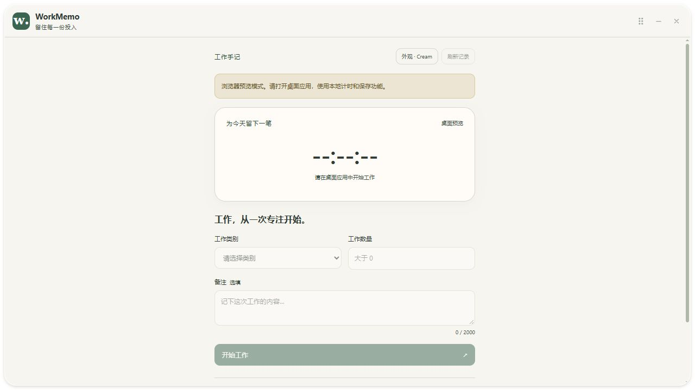

# WorkMemo 第五阶段：主界面与工作状态交互

日期：2026-10-26（Asia/Shanghai）。起点 a956a8a，main 与 origin/main 一致且工作区干净。用户确认继续第五阶段；本阶段完成后等待确认，不进入历史查询、删除和统计。

## 1. 本次目标与检查

开发前阅读 PRODUCT-SPEC.md、AGENTS.md，检查 React 表单、任务 Hook、窗口组件、主题、Rust 命令、计时与 SQLite 服务及 Tauri 配置。原工程可以启动，已支持真实任务、可靠计时、原生透明、四种皮肤和独立外观保存。

现有界面结束任务后直接回到零时长，没有明确的完成保存确认；业务按钮提交期间没有相应文案；首次读取失败仍容易被理解为准备开始；表单只有通用错误，不能定位错误字段。

最小改动只涉及前端状态展示、字段校验及文档测试。Rust 业务、SQLite 表结构、数据路径、迁移、权限、原生窗口和主题配置均沿用现有实现，没有增加依赖。

## 2. 完成的行为

- 明确区分读取中、准备开始、进行中、暂停、完成保存、不可用和浏览器预览。未取得快照前显示占位时长，避免把未知数据当作空任务。
- 连接失败保留上次真实任务与时长，提示暂未更新，并禁用业务操作。错误提示按连接错误、命令错误、后台警告的顺序展示，避免同时堆叠重复错误。
- 开始、暂停、继续、结束期间显示对应的处理中按钮；保留原有同步 busyRef 防重复与请求 revision 防过期覆盖机制。
- 只有结束命令成功，并且 Rust 返回的快照包含同 id、FINISHED、非空结束时间且无活动任务时，才显示已完成并保存。保留本次有效时长、数量、备注与结束时间，提供下一项表单。
- 保存失败保留原任务和表单；旧历史、仅点击按钮、失败结果或浏览器预览不能产生成功确认。开始新任务成功后清除本次保存提示；重启不把历史记录当作本次操作成功提示。
- 表单分别标明类别、数量、备注错误，焦点落在首个错误字段；编辑该字段时清除旧错误，再次提交重新校验。字段有 aria-invalid 和关联说明。
- 数量接受正小数及科学计数，范围为大于 0 且不超过 10 亿。备注去除首尾空白后按 Unicode 字符计数，最多 2000 字符。Rust 保留最终校验。
- 计时器直接展示 Rust 快照的有效时长；没有添加前端逐秒累加。读屏状态只随工作状态变化，时长每秒变化不自动播报。

## 3. 文件关系与完整代码

完整绝对路径和 NEW FILE / UPDATE 清单见 PHASE-5-FILES.md；变更源码、测试、配置和开发说明的完整内容见 PHASE-5-SOURCE.md。实际源文件也完整保存在项目中，未用省略号代替代码。

workInput.ts 提供独立字段校验，WorkForm.tsx 负责输入、错误关联与焦点；workView.ts 从真实快照和本次成功结束的 id 派生界面状态，useWorkSession.ts 记录当前提交命令和成功结束 id，App.tsx 组合展示。App.css 只补充字段错误、字数和完成提示，继续使用皮肤令牌。

## 4. 实际检查与测试

- TypeScript 与 Vite 生产构建通过。
- 新增 Node 内置测试 9 项通过：正数边界、小数与科学计数、非法输入、Unicode 备注、首次读取失败、连接中断恢复、暂停保持任务、真实完成确认及浏览器不能启用业务操作。
- 原主题测试 6 项通过；Rust 回归测试 23 项通过；Rust 格式检查通过。
- Node 状态测试是纯函数测试，不能替代真实 IPC、界面点击和磁盘故障验收；测试夹具只存在于测试文件，不注入应用或用户数据库。
- Tauri 开发版实际启动通过。桌面可访问性树读取到正常主界面、就绪状态、表单及当前已保存的 Glass 外观。当前配置与上阶段记录的 Dark 不同，沿用本次磁盘内容，未擅自改回旧设置。
- 原生工具点击两次均报 `coordinate input geometry is unavailable`，重新选择窗口并激活后仍未恢复；没有将这些点击报告为通过。
- 用户随后人工确认：空表单提示、开始、暂停、继续、结束后的已完成并保存和本次时长「全部正常，已保存并关闭」。进程检查确认开发窗口退出。
- 浏览器只检查真实预览页面：有预览提示、未知时长占位、业务输入/按钮禁用，未填充虚构业务数据。截图 phase-5-preview.png 仅用于布局检查，不作为原生透明或保存证据。

- Release 正式构建通过，耗时 2 分 12 秒。可执行文件 E:\WorkMemo\src-tauri\target\release\workmemo.exe，6,105,088 字节。SHA256：C1FECA7A17C3B5D60E6F68D07E3F2DFC7505FCD583BDE90440CE226867769478。
- 开发版退出后，确认 1420 端口无监听。尝试打开正式版时，桌面工具报告用户以物理 Escape 停止操作；停止进一步桌面输入，随后进程检查未见 WorkMemo。因此本轮正式版独立重开与重开后的外观显示仍待验收，不能报告为通过。磁盘外观配置保持 Glass、82%。

## 5. Windows PowerShell 命令

```powershell
Set-Location 'E:\WorkMemo'
$env:Path = (Join-Path $env:USERPROFILE '.cargo\bin') + ';' + $env:Path
npm ci
npm run test:workflow
npm run test:themes
npm run build
cargo test --locked --manifest-path .\src-tauri\Cargo.toml
cargo fmt --manifest-path .\src-tauri\Cargo.toml -- --check
npm run tauri dev
```

先保存关闭开发版，再构建及独立打开正式版：

```powershell
npm run tauri build -- --no-bundle
& 'E:\WorkMemo\src-tauri\target\release\workmemo.exe'
```

## 6. 逐步测试方法与预期

1. 启动桌面版：读取中不出现虚假的就绪状态；快照成功后显示真实任务或开始表单。断线与首次失败的展示由纯函数测试覆盖，本轮未人为损坏用户数据。
2. 空表单提交：类别与数量旁各有错误，并聚焦类别；只改一个字段不会清除其他字段错误。数量为 0、负数、非法字符串或超上界不能启动。
3. 选择类别、输入正数和实际工作备注后开始：进入进行中，只出现同一活动任务；按钮提交期间禁用。
4. 暂停并等待：时长保持；继续后累计原有效时长，不新建任务。
5. 结束：只有成功返回后出现已完成并保存，本次时长与数量保留；最近记录中存在相同任务。
6. 开始下一项：完成提示消失，显示新的活动任务。暂停后开始另一项仍沿用原来的原子保存切换规则。
7. 换肤、打开关闭面板：主任务不变；正常关闭和重开：活动任务仍按原规则恢复暂停，最近真实记录保留，外观沿用保存值。
8. 后端写入失败：不显示本次保存成功，输入不清空，允许核对后重试。数据库写入与切换失败的回滚由 Rust 临时数据库测试覆盖，没有修改真实用户数据制造故障。

其中 2–5 已由用户对开发版确认；其余已有回归和本次自动测试覆盖，完整跨环境业务与恢复验收留待第七阶段。

## 7. 兼容性与边界

本机 Windows 10 x64、WebView2 155、Node 24 和 Rust MSVC；没有升级依赖或增加权限。Node 测试直接读取 TypeScript，需要支持原生 TypeScript 类型擦除的 Node（本机 Node 24）。应用本身的运行环境仍是 Windows/WebView2。

高 DPI、多显示器、不同 GPU/背景、读屏软件实际播报、真实断电及安装包尚未完整验收。原生透明和基础窗口操作保留前三、四阶段的用户验收记录；本轮未重新声称覆盖所有皮肤和窗口环境。



## 8. Git 同步与下一阶段

按用户授权，检查暂存区、排除依赖/产物/真实数据库/凭据，提交并推送 main，推送后核对本地和远程提交标识及工作区。同步不代表未执行的兼容性检查已通过。

```powershell
git fetch origin main
git add .
git diff --cached --check
git commit -m "feat: clarify work states and save feedback"
git push origin main
git rev-parse HEAD
git ls-remote origin refs/heads/main
git status --short --branch
```

完成本阶段后等待用户确认，再进入第六阶段的完整历史查询、确认删除和真实数据统计。
