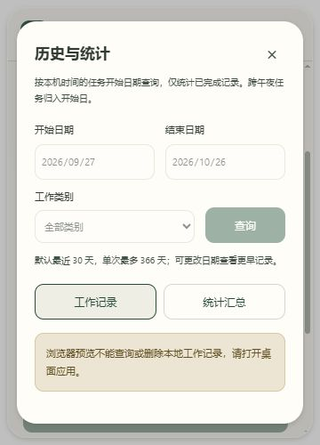

# WorkMemo 第六阶段：历史查询、删除和统计

日期：2026-10-26（Asia/Shanghai）。用户确认继续第六阶段。起点 b650dbb，main 与 origin/main 一致、工作区干净；本阶段完成后等待确认，不自动进入第七阶段。

## 1. 目标与实际检查

开发前阅读 AGENTS.md、PRODUCT-SPEC.md，检查 React 主界面、表单、任务 Hook、窗口和主题，Rust 任务状态机、SQLite 表及版本、后台检查点、Tauri 命令与权限、既有测试。原工程已有可靠计时、任务保存和原生透明换肤；历史仅为最近 5 条，无完整查询、删除或统计接口。基线 Tauri 开发版实际启动成功。

最小方案沿用原 SQLite 连接、Store 锁和 work_records 表，增加类型化历史查询与删除接口；前端新增轻量面板和独立 Hook，不引入依赖、不改变 schema/user_version，不增加通用 SQL 或文件系统权限。历史面板不挂载新的任务计时 Hook。

## 2. 查询与统计口径

- 主界面下方「查看历史与统计」打开模态面板，支持工作记录和统计汇总两种内容。
- 默认最近 30 个本地日历日，起止日期两端包含；可选择任意更早日期与四种类别之一。单次最多 366 天，限制的是单次返回量，不是保存期限。全部历史记录仍保存在原数据库中，可分日期范围查询。
- 每页 20 条，以 start_time、id 双重倒序保证相同开始时间下顺序明确。删除末页最后一条后，后端将页码收敛到剩余最后一页。
- 列表显示开始日、类别、数量、备注、开始/结束时间和有效时长。无备注明确显示未填写，没有示例记录或虚构数字。
- 仅统计 FINISHED；工作中或暂停任务不加入历史汇总。日期按电脑本地时区的任务开始日归属，跨午夜记录整条归入开始日。不是跨日时长分摊。
- 全部已完成总览覆盖整个数据库；当前范围、每日及类别汇总覆盖全部筛选结果，不限于当前页。分类/每日表只包含真实非空分组。
- 数量按 SQLite REAL 直接相加，界面最多显示 12 位有效数字以减少浮点尾差；不同类别数量直接相加，不推断业务单位。时长先 SUM(duration_ms) 再取整展示到秒，保留原始记录亚秒精度。
- 默认范围使用本地日历回退，不以固定的 30×24 小时替代日历日。后端独立校验真实日期、闰日、范围、类别与页码，所有用户值以参数绑定传入 SQL。
- 记录、筛选计数、每日汇总、类别汇总及全部总览在同一个只读事务中生成，避免各视图来自不同数据时点。历史查询不会改变或强制检查点保存当前任务。

## 3. 删除与异步一致性

删除先打开第二层模态确认，展示该条真实记录的类别、数量、起止时间、有效时长和备注，说明不可撤销；默认焦点在取消。取消或 Esc 不调用删除接口。确认后等待 Rust 成功响应，期间禁用重复提交及关闭确认。

Rust 删除事务限定 id 和 FINISHED 状态；非法 id、不存在、正在工作或暂停任务都拒绝，不能删除活动任务。SQL 或提交失败返回错误，事务回滚，界面保留确认和错误，不显示删除成功。

成功后重新读取历史和汇总，并通知主任务 Hook 立即移除该 id 的最近记录与完成提示。只在成功删除后保存本进程已删 id 集合；任何较早请求返回的旧快照也会经过此集合过滤，不能短暂复活已删记录。集合不作为业务持久化，重启以真实 SQLite 为准。

历史请求通过 revision 校验避免旧查询覆盖新筛选；面板关闭或卸载时使在途结果失效。删除成功但后续查询失败时，明确保留已删除提示并显示读取错误，不能把读取失败显示为空列表或声称统计已更新。

## 4. 文件与完整代码

完整绝对路径和 NEW FILE / UPDATE 标记见 PHASE-6-FILES.md；所有变更源码、测试、配置和开发说明的完整内容见 PHASE-6-SOURCE.md；原文件也完整保存在对应项目路径。

- history.rs 是 database.rs 的子模块，复用 Store 私有连接和记录读取函数；通过类型导出向 service.rs 提供受限接口。
- service.rs 将原命令公共锁访问抽为 access，原 start/pause/resume/finish 仍执行 action 后返回 snapshot；历史查询和删除单独返回自身结果。
- HistoryPanel.tsx 提供日期/类别、分页、统计表和删除确认；useHistory.ts 管理请求、错误与取消；history.ts 提供类型、日历校验和格式化。
- App.tsx 组合入口和数据变更通知；useWorkSession.ts 与 workView.ts 处理已删记录的过期快照；App.css 继续引用主题令牌。
- 历史持久化与计时、窗口配置、原权限和皮肤存储保持兼容；没有新增数据库或迁移。

## 5. 实际测试与限制

- Rust 33 项通过，0 失败：原 23 项保留，新增 10 项历史测试，覆盖真实空数据、日期/类别、同时间分页、删除末页收敛、亚秒汇总与跨午夜归属、非法查询、闰日与 366 天限制、活动/暂停任务保护、删除后一致性、删除失败回滚及删除后重开。
- 新增 Node 历史测试 7 项通过；原工作状态 9 项和主题 6 项通过，共 22 项前端纯函数测试、55 项自动测试。覆盖本地日历范围、闰日、无效输入、数量显示及过期快照不能复活已删记录。
- TypeScript 与 Vite 生产构建通过，Rust 格式检查通过。没有增加测试框架依赖。
- 测试夹具只在内存/独立临时测试数据库中使用，不加载到产品、不写入用户真实工作数据库。删除失败通过临时数据库触发器模拟，不人为损坏真实文件。
- 浏览器实测：入口打开、工作记录/统计切换、Esc 关闭及焦点回到入口；360×500 布局无明显控件溢出。浏览器数据入口禁用且有明确提示，没有假装调用本地数据库。截图 phase-6-browser-preview.png 只证明浏览器布局，不证明真实记录、原生透明或删除。
- 桌面开发检查遇到旧正式版占用数据锁，新开发版正确报告数据锁错误而未打开数据库。只读锁探测及进程检查确认旧正式版仍在运行；用户随后确认保存关闭。没有强制结束旧正式版或删除锁文件。

- 第一轮正式构建通过，耗时 1 分 58 秒；开发服务关闭、1420 无监听时，通过桌面工具独立启动 release/workmemo.exe。可访问性树确认页面来自 http://tauri.localhost/，读取到当前 Glass 外观、正常任务状态和历史入口，未出现数据锁错误。
- 用户对该正式版人工确认「查询、汇总和实际删除均正常」，确认问题包括日期/类别筛选、统计核对、删除详情、取消及实际删除后列表/汇总更新。
- 随后复核补充确认框 onCancel 的 stopPropagation，防止 React 事件向历史父面板传播：Esc 只取消删除并保留历史。此次微调会重新纳入最终构建；最终 Esc 行为未再次人工验收，保留待下次复核。
- 更新前桌面工具报告用户按物理 Escape 停止操作，停止后续桌面输入；用户随后确认手工保存关闭。没有通过其他 UI 自动化绕过停止信号。最终构建后本轮不再进行桌面操作。

- 最终 Release 构建通过，耗时 1 分 57 秒；E:\WorkMemo\src-tauri\target\release\workmemo.exe，6,164,480 字节。SHA256：219912172D4DE81D9B836FB3053E92BB53655EDCDCE746C9AC0818519C1F8C68。构建后进程检查无 WorkMemo、1420 无监听，程序留待用户手动打开；最终版本的独立重开和 Esc 微调尚未再次验收，上述正式版人工反馈对应微调前构建。

## 6. PowerShell 命令与逐步验收

```powershell
Set-Location 'E:\WorkMemo'
$env:Path = (Join-Path $env:USERPROFILE '.cargo\bin') + ';' + $env:Path
npm ci
npm run test:history
npm run test:workflow
npm run test:themes
npm run build
cargo test --locked --manifest-path .\src-tauri\Cargo.toml
cargo fmt --manifest-path .\src-tauri\Cargo.toml -- --check
npm run tauri dev
```

先正常保存关闭旧窗口后再构建/打开正式版，避免同时运行的版本持有同一数据库：

```powershell
npm run tauri build -- --no-bundle
& 'E:\WorkMemo\src-tauri\target\release\workmemo.exe'
```

逐步方法及预期：

1. 打开历史，默认日期最近 30 天，能看到原有真实已完成记录；类别、数量、备注、开始/结束与时长和主界面最近记录一致。
2. 按类别、日期查询；空范围显示空状态。清空日期、倒置日期、超过 366 天应明确拒绝。可以查询更早的任意有效时间范围。
3. 多于 20 条时翻页；每页最多 20 条，无同开始时间导致的重复/漏页；统计总数覆盖所有筛选页。多页通过 41 条隔离测试夹具验证，不在用户数据库中填充假记录。
4. 切换统计：每日、类别与当前范围数量/时长能核对相等；全部总览不随筛选缩小。
5. 点击一条记录删除，核对详情后取消或 Esc，记录与汇总保持。如果用户确实要删除一条不需要的记录，再确认删除；成功后列表、最近记录及各汇总更新，重开不恢复已删记录。不要为了测试删除重要工作记录。
6. 保持进行中或暂停任务，打开面板查询/关闭，不改变任务 id、时长规则或皮肤；活动任务不在可删除列表中。
7. 模拟查询/删除失败只用自动测试的临时数据库；产品应显示错误、保留数据，读取失败不能显示零记录，重复点击不能产生重复操作。
8. 正常保存关闭并独立重开正式版，核对外观、历史和活动任务恢复。完整窗口、恢复、多时区和跨平台兼容留待第七阶段。

## 7. 兼容性与边界

面向本机 Windows 10 x64、WebView2 155、Node 24、Rust MSVC。沿用现有 schema 版本 1，前后端数据路径与外观配置不变，无新依赖或权限。Node 纯函数测试依赖支持 TypeScript 类型擦除的 Node，本机为 24。

本地日期基于操作系统当前时区，改变系统时区可能改变既有开始日的分组；未逐个验证其他时区和夏令时环境。单次 366 天避免一次返回无限每日分组；全库总览仍扫描真实已完成数据，大规模归档性能尚未专项压测。高 DPI、多显示器、不同 GPU、读屏播报、真实断电和安装包未完整验收。



## 8. Git 同步

按既有授权，检查暂存区并排除依赖、构建产物、真实工作数据库、凭据及本地外观配置。推送后比较本地与远程提交，确认工作区状态；未通过的人工验收不因推送而视为通过。

```powershell
git fetch origin main
git add .
git diff --cached --check
git commit -m "feat: add history queries deletion and work summaries"
git push origin main
git rev-parse HEAD
git ls-remote origin refs/heads/main
git status --short --branch
```

本阶段结束后等待用户确认，再进行第七阶段综合验收。
