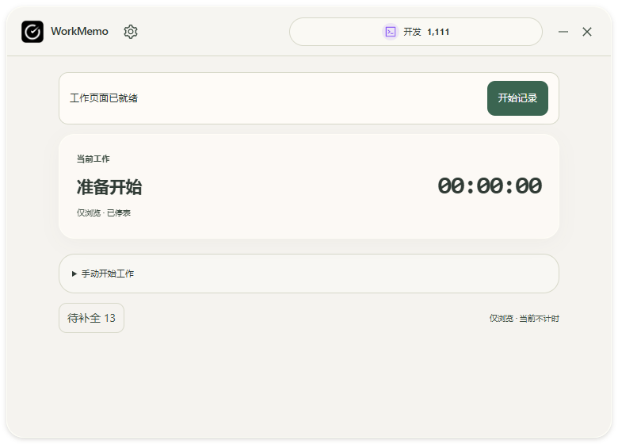

# 主窗口单一设置入口与顶部空间规划

日期：2026-10-29（Asia/Shanghai）。源码交付，未重新打包或发布安装器。

## 目标与检查

按用户截图要求，红框内只保留设置，移除历史统计、外观、布局三个顶部快捷按钮。检查了产品规范、第八阶段、`App`、共享 `DesktopWindow`、标题栏 CSS 和设置窗口；工作区原有未跟踪的 `docs/DYNAMIC-ISLAND-PLAN.md` 保留，不纳入提交。

原先标题栏只有标识处可拖动，其余空间主要被四个入口及工作量胶囊占用。设置窗口本来已经包含外观、工作名称与外观、监测、布局和数据管理，因此无需再造菜单或删除功能。

## 已实现的顶部规划

```text
[应用标识] [设置]  ← 可拖动留白 →  [今日工作量] [最小化] [关闭到后台]
```

- 左侧：保留应用标识，只显示一个齿轮设置入口，继续打开原设置窗口的监测页；外观与布局通过设置内已有栏目进入。
- 中间留白：新增独立原生拖动区域，调用现有 `startDragging`；设置、工作量和窗口按钮均在拖动区之外，不发生误拖动。
- 工作量胶囊：紧凑模式最大宽度 240px，舒展模式最大 320px；仍能打开当天完整工作详情。长类别名称优先收缩、省略，数量保持完整。
- 右侧：保留最小化和关闭到后台，沿用现有操作及错误处理。
- 紧凑标题栏高度 42px，设置点击区 28×28px，拖动留白至少 24px；舒展标题栏沿用 62px，高度不新增，拖动区至少 32px。600px 以下不显示品牌文字，保留标识。
- 设置等二级窗口不带工作量胶囊，继续使用原标题栏布局；状态岛和网页组件不调整。没有新增依赖、配置、权限、Rust 命令或数据库变更。

实际隔离浏览器测得：420px 紧凑窗口拖动区为 34px，360px 紧凑窗口为 24px，780px 舒展窗口约 158.59px。

## 验证结果

- 前端开发服务器实际启动成功；49 项 Node 测试和 TypeScript／Vite 生产构建通过。原有大块资源告警保留。
- 新增 22 组隔离布局检查：360／420／600／780px、紧凑／舒展、四种皮肤、空数据、0、待补填、超长类别、大数量、工作／暂停、读取失败及 18px 字号。仅有一个设置按钮，标题栏元素不重叠，数量可读，拖动区达到最小宽度。
- 验证设置调用、当天工作量入口、拖动、最小化及关闭命令。设置点击不触发拖动，测试没有发送创建、暂停、结束或结算任务命令。
- 原有桌面四皮肤状态岛、暂停／继续、仅浏览／开工和设置布局隔离浏览器回归通过。根节点透明背景的 CSS 检查通过。
- 截图在工作快照读取完成后保存；均为显式隔离夹具，没有写入真实数据库。原生 Windows 透明、DPI、实际拖动及窗口动作本轮未重做验收，模拟 IPC 不代表这些原生项目通过；Rust 测试未重跑。




## 完整路径与代码

| 状态 | 完整路径 |
| --- | --- |
| UPDATE | E:\WorkMemo\src\App.tsx |
| UPDATE | E:\WorkMemo\src\DesktopWindow.tsx |
| UPDATE | E:\WorkMemo\src\App.css |
| NEW FILE | E:\WorkMemo\scripts\verify-titlebar.mjs |
| UPDATE | E:\WorkMemo\README.md |
| UPDATE | E:\WorkMemo\docs\USER-GUIDE.md |
| UPDATE | E:\WorkMemo\docs\PHASE-8.md |
| NEW FILE | E:\WorkMemo\docs\TITLEBAR-UPDATE.md |
| NEW FILE | E:\WorkMemo\docs\TITLEBAR-SOURCE.md |
| NEW FILE | E:\WorkMemo\docs\assets\titlebar-2026-10-29\compact-420.png |
| NEW FILE | E:\WorkMemo\docs\assets\titlebar-2026-10-29\comfortable-780.png |

完整代码和源码清单见 [TITLEBAR-SOURCE.md](TITLEBAR-SOURCE.md)。主界面负责入口，窗口框架提供独立拖动区域，CSS 只对带工作量的主标题栏增加五列布局，测试脚本只连接隔离 IPC。

## PowerShell 命令与验收方法

```powershell
Set-Location E:\WorkMemo
npm.cmd test
npm.cmd run build
# 单独窗口启动浏览器预览，不启动真实计时后端。
npm.cmd run dev -- --host 127.0.0.1
```

另一个 PowerShell 窗口执行（其他电脑将 Playwright 路径改成本机安装位置）：

```powershell
Set-Location E:\WorkMemo
$env:WORKMEMO_PLAYWRIGHT = 'C:\Users\Administrator\.cache\codex-runtimes\codex-primary-runtime\dependencies\node\node_modules\playwright\index.mjs'
node scripts/verify-titlebar.mjs
node scripts/verify-ui-022.mjs --desktop-only
git diff --check
```

预期：脚本成功退出，`artifacts/titlebar/qa/result.json` 包含 22 组布局且 `errors` 为空。人工在新源码构建中检查左侧只有设置，点击设置仍能切换外观、布局等栏目；拖动留白能移动窗口，点击设置与工作量不会拖动。当前已安装程序不会因源码更新自动变化。

```powershell
$titlebarPaths = @(
  'src/App.tsx', 'src/DesktopWindow.tsx', 'src/App.css', 'scripts/verify-titlebar.mjs',
  'README.md', 'docs/USER-GUIDE.md', 'docs/PHASE-8.md',
  'docs/TITLEBAR-UPDATE.md', 'docs/TITLEBAR-SOURCE.md',
  'docs/assets/titlebar-2026-10-29/compact-420.png',
  'docs/assets/titlebar-2026-10-29/comfortable-780.png'
)
git add -- $titlebarPaths
git diff --cached --stat
git diff --cached --check
git commit -m "fix: simplify desktop navigation and rebalance titlebar"
git fetch origin
git rev-list --left-right --count HEAD...origin/main
git push origin main
git rev-parse HEAD
git ls-remote origin refs/heads/main
git status --short
```

只暂存上述明确文件，不提交真实数据、依赖、构建产物或原有未跟踪规划。远程若有新提交，先安全整合，禁止强制推送。本步骤结束后等待用户验收，不自动进入安装包发行阶段。
