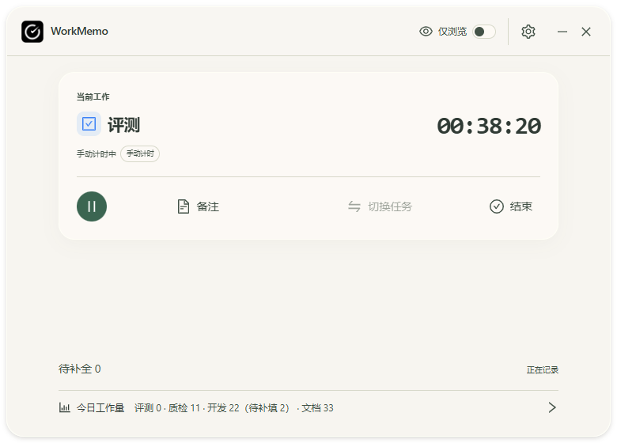
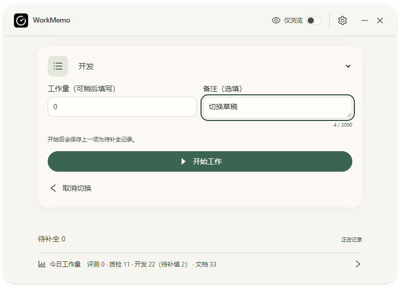

# v0.2.5 第一阶段：现有 UI、固定状态岛与开机启动

日期：2026-10-30（Asia/Shanghai）。状态：本阶段源码实现和自动化检查完成，原生验收受限；尚未进入正式打包／公开发布阶段。普通用户下载仍为 v0.2.4，本阶段不提前修改发行版本号、标签或安装包。

## 目标与现有检查

以 E:\WorkMemo 的 v0.2.4（402f8e2）为基础，先阅读 AGENTS.md、PRODUCT-SPEC.md、PHASE-8.md、现有状态岛和发行记录，再检查 React、Rust、窗口、业务接口、运行进程和 Git 状态。开始时没有 WorkMemo 进程，已有未跟踪的 E:\WorkMemo\docs\DYNAMIC-ISLAND-PLAN.md 原样保留，不覆盖或随本次提交。

用户已确认：暂停后才能切换；自启进入托盘后台；工作量直接在岛内填写；状态岛保留拖动，但展开不移位；顶部工作量移到底部文字栏。用户提供的参考设计作为布局、比例与操作排列参考，图中的名称、数量、时长不进入产品数据；既有四皮肤、背景设置、图标和业务规则沿用。

参考图：[用户参考设计](assets/v0.2.5/reference.jpg)。以下截图来自隔离 IPC 夹具，全部为明确的测试数据，不读取真实工作数据库，也不是原生透明验收结果：





## 本阶段改动

- 顶部保留标识、设置、拖动区及最小化／关闭到后台，新增眼睛图标和「仅浏览」。开启以主题强调色显示；移除独立浏览横栏与底部重复入口。退出浏览仍依赖现有工作页面就绪条件。
- 当前任务保留名称、后端工时、暂停／继续、备注和结束；双箭头切换同排显示，运行或待恢复时禁用。暂停后进入独立新建页，原任务面板不同时展示。
- 新建页提供融入面板的类别选择、始终可见的工作量与可选备注、开始和取消切换。保留数量可空、明确 0、科学计数及原上限校验；开始切换仍确认并携带旧任务 ID，调用现有后端原子操作。取消不结束旧任务，失败和原任务状态变化时保留输入。
- 复用主题变量、窗口尺寸和内容滚动；图片背景轻微模糊，不降低文字透明度。底部用横向文字展示真实当日分类工作量及待补全信息，首次读取显示加载文字；只在溢出时连续循环，悬停／聚焦暂停，减少动态效果时静止并可横向浏览。点击仍打开当天详情。
- 状态岛使用固定的 320×420 逻辑像素画布（短屏限高），收起占位 320×56，可见主体外框 312×48、圆角 20。上方内容行固定；下方与主体共用一层主题材质，没有连接处分隔边框。展开不再改变原生整窗尺寸或重算位置；恢复、拖动完成时才按完整展开范围校正边界。
- 将已存在的 Ant Design 生态 @rc-component/motion 1.3.3 声明为直接依赖，用 CSSMotion 控制约 200ms 的 height、opacity、translateY；支持减少动态效果、快速反向和过期收起回调保护。Windows SetWindowRgn 随可见高度裁剪，避免保留整块透明点击层。浏览器验证无法证明原生裁剪或点击结果。
- 开工、空闲、结束提示进入统一展开区；结束后复用 SettlementForm、Rust settle_record 和记录修订号校验在岛内填写。仅保存成功后收起；失败／冲突保留输入，并提供原待补全列表核对入口。编辑时固定原记录，轮询与新活动任务不替换草稿；放弃未保存内容需要明确确认。
- 原生画布展开期间持有可见状态，保存和草稿纳入现有退出保护；收起动画结束后再释放。自动提示沿用不激活显示路径，未新增开始／恢复通知或第二套计时器。
- 新增独立 startup.json 与仅限设置窗口的自启开关。正式 Windows release 程序首次运行默认启用，登录参数 --autostart 保持主窗口隐藏，普通启动打开主窗口。用户关闭或 Windows 任务管理器禁用后不强行重新开启；损坏配置保留并报告错误。
- 自启插件锁定 Tauri 官方 2.5.1，核对其 Windows 实现只使用 HKCU；不使用会尝试全用户注册的新版默认实现。补齐含空格路径引号及写后校验，失败尝试恢复原 Run 项，界面重新读取实际状态。单实例插件先注册，重复手动启动唤起原窗口，重复自启保持后台。
- 开发和非正式标识预览不注册启动项；没有新增前端系统注册表权限。卸载仅移除命令完全匹配本安装目录的自启值，保留更新版本或其他目录的所属项。NSIS 回归将路径映射到 GUID 私有注册表命名空间。

公开业务类型、计时参数、SQLite schema 9、正式应用标识与数据路径均保持。新增 IPC 为 get_startup_status、set_startup_enabled、get_island_viewport、fit_island_position、set_island_region、hold_island，并验证调用窗口标签／尺寸边界；新增 startup-changed 事件同步启动错误状态。

## 实际检查与限制

- Node 49 项测试通过；Rust 141 项库、2 项 helper、2 项原生主机、1 项注册集成，共 146 项通过；Cargo 格式和 TypeScript／Vite 生产构建通过。
- 新版隔离 UI 回归 9 组通过，含四皮肤×两种密度×三档宽度共 24 组布局、大字号／长名称、两页宽度一致、暂停切换／取消、状态变化、失败保留草稿、浏览就绪、静止／循环统计、减少动态效果、快速重开、结算冲突、旧结算不覆盖新任务、自动收起和自启保存失败反馈。开发资源和生产资源均实际执行通过。
- 收起过程逐帧采样确认上方内容行 x/y、310×46 的内部尺寸和圆角保持一致，外框含边框为 312×48；下方存在连续的中间高度和透明度，最终回到 0 高。证据：E:\WorkMemo\artifacts\0.2.5\qa\island-frames.json。
- 原顶部 22 组布局／按钮／拖动检查通过；原桌面四皮肤状态岛、布局设置、工作名称及多 URL 隔离回归通过。
- NSIS 两组正式／预览身份的隔离安装、ZIP 修复、旧卸载器保护、新所有者与本目录自启清理均通过。脚本比较真实 Chrome 和真实 WorkMemo Run 值前后保持一致；没有打开工作数据库。
- 独立标识 com.workmemo.test.v025 的 Windows debug 程序实际构建成功。复制到无浏览器 helper 的隔离目录后，以 --autostart 启动未出现主窗口；再次手动启动唤起同一进程。可访问性树读取到 tauri.localhost 的真实界面与空隔离数据库；未创建、暂停、结束或删除真实任务。
- 原生截图失败：FrameArrived timed out。重新选择窗口后只读可访问性读取成功；后续原生操作被用户物理 Esc 停止。本轮此后没有继续鼠标／键盘操作，最终重建也没有自动启动程序。
- 使用的技能为 C:\Users\Administrator\.codex\plugins\cache\openai-bundled\computer-use\26.1027.30824\skills\computer-use\SKILL.md，其 guidance.md 要求遇到用户中断后 “stop issuing app input”。这解释原生操作停止，不代表所有原生项目已通过。
- 原生透明／磨砂、状态岛区域裁剪与桌面点击、实际拖动／焦点、多屏 DPI、真实 Windows 登录自启与正式设置注册，以及正式升级／卸载尚未完成本版端到端验收。隔离 IPC、NSIS 命名空间测试、启动参数检查不能代替这些结果。
- 网页懒加载图表块仍约 1508.79kB（gzip 489.80kB），Vite 报告超过 500kB 的现有大块资源提示；没有隐藏告警。本阶段未打包签名版或发布新版成品。

详细日志及回执位于 E:\WorkMemo\artifacts\0.2.5\qa，不加入 Git。较早失败调试文件保留在该目录，最终结果以 ui-production-result.json、ui-result.json、rust-tests.log、installer-hooks.log 及本记录为准。

## 文件与完整代码

[完整 NEW FILE／UPDATE 路径与仓库源码清单](UPDATE-0.2.5-PHASE-1-FILES.md)，[全部本阶段程序、配置、测试和锁文件的完整文本](UPDATE-0.2.5-PHASE-1-SOURCE.md)。代码完整保存在项目原文件中，源码汇编不使用省略号替代内容；图片以原始二进制文件交付。

## PowerShell 命令与复核

```powershell
Set-Location E:\WorkMemo
npm.cmd ci
npm.cmd test
npm.cmd run build
cargo fmt --manifest-path src-tauri/Cargo.toml -- --check
cargo test --locked --manifest-path src-tauri/Cargo.toml
& .\scripts\test-browser-registration.ps1
```

预期：Node 49、Rust 146 项通过，生产构建成功；隔离安装器测试输出 PASS，正式 Chrome／启动项前后不变。NSIS 测试需要已有本机 Tauri NSIS 和支持私有命名空间的 debug helper；没有该 helper 时先单独构建 `cargo build --locked --manifest-path src-tauri/Cargo.toml --bin workmemo-browser`。测试过程不连接正式工作库。

在单独 PowerShell 启动 `npm.cmd run dev -- --host 127.0.0.1` 和 `npm.cmd run preview -- --host 127.0.0.1 --port 1422 --strictPort` 后：

```powershell
$env:WORKMEMO_PLAYWRIGHT = 'C:\Users\Administrator\.cache\codex-runtimes\codex-primary-runtime\dependencies\node\node_modules\playwright\index.mjs'
node scripts/verify-v025.mjs
node scripts/verify-titlebar.mjs
node scripts/verify-ui-022.mjs --desktop-only
node scripts/verify-v023-phase1.mjs
node scripts/verify-multi-url.mjs
$env:WORKMEMO_UI_URL = 'http://127.0.0.1:1422/'
node scripts/verify-v025.mjs
Remove-Item Env:WORKMEMO_UI_URL
```

其他电脑将 Playwright 路径替换为本机安装位置。预期新版输出 9 组交互／24 组布局，顶部输出 22 组，其余脚本成功退出；浏览器中的业务命令被隔离夹具拦截，不写真实数据。

原生后续验收应使用独立标识、独立数据与浏览器注册命名空间，依次验证真实桌面透明、展开时主体坐标／尺寸不变、透明区域不阻挡点击、保存失败不收起、成功后收起、编辑期间新任务、焦点、多屏与重启。正式登录自启需在明确的成品验收阶段实际测试，不通过注销／重启当前电脑强行验收。

## 兼容性、Git 与阶段边界

继续使用 Windows 10／11 x64、WebView2、Tauri 2／React／TypeScript／Vite／Rust／SQLite。npm 原有包版本不升级；新增直接动画依赖复用已有锁定版本。Rust 新增官方启动和单实例插件，锁文件新增其跨平台解析依赖，不代表所有锁文件条目都编入 Windows 成品。偏好与工作数据分离，不迁移或重置工作库。

按 AGENTS.md 授权，检查暂存区后提交、推送 main，不重复请求推送许可；不提交 artifacts、target、node_modules、数据库、凭据或原有未跟踪规划。推送前 fetch 检查远程进展；若有新增提交，安全整合并复核，禁止强推。身份沿用本仓库已配置身份，不修改全局设置。

```powershell
git diff --cached --check
git diff --cached --name-status
git commit -m "feat: refine desktop UI, fixed island and startup for v0.2.5"
git fetch origin
git rev-list --left-right --count HEAD...origin/main
git push origin main
git rev-parse HEAD
git ls-remote origin refs/heads/main
git status --short
```

本次源码阶段结束后总结并等待用户确认。后续再统一 0.2.5 版本并打包／公开发布，不移动 v0.2.4 标签，不覆盖旧下载，不为验收强制处理用户真实任务。
