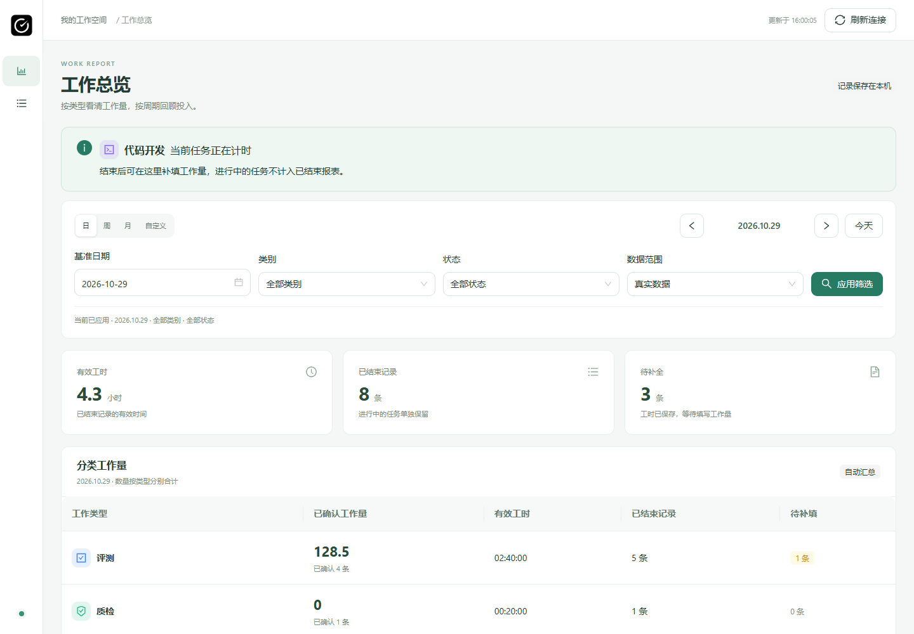
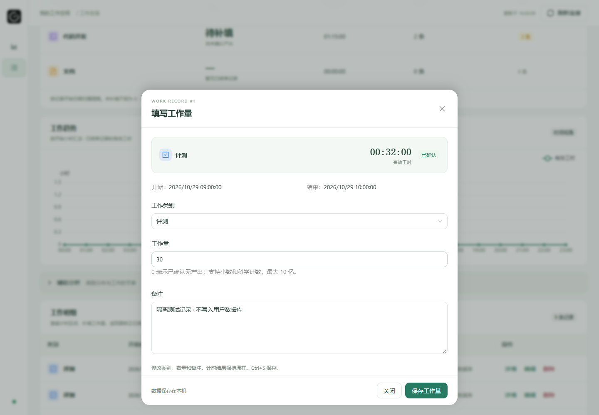
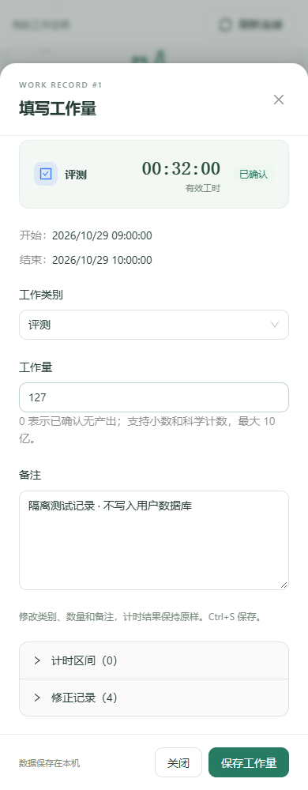
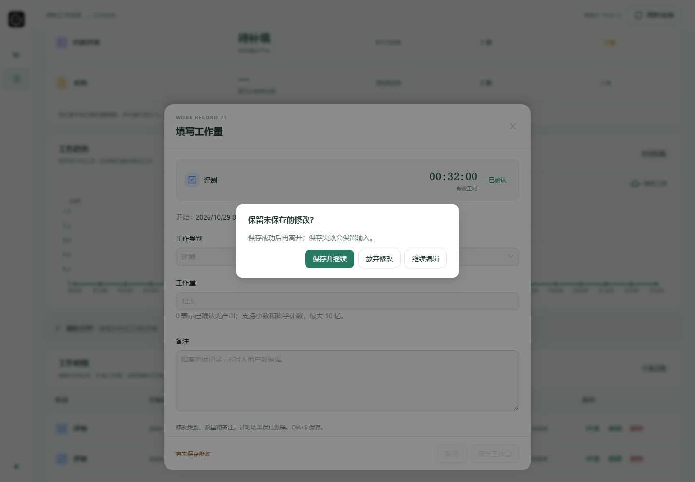

# WorkMemo 网页端优化交付

日期：2026-10-29（Asia/Shanghai）。状态：源码阶段交付，不替换公开 v0.2.3 安装器、ZIP 或用户当前程序。

## 目标与实际检查

按用户确认的方案，将网页数据中心统一为完整 Ant Design，修复保存工作量后背景闪动，并将详情改为从底部浮出的弹窗。保留原计时、SQLite、统计、权限和 Chrome 扩展协议。

检查起点为 `main` 的 `c08a050`，与 `origin/main` 一致；开始时存在运行中的正式程序，未对它发送暂停、结束、删除或退出操作。原工作区有未跟踪的 `docs/DYNAMIC-ISLAND-PLAN.md`，保留且不纳入本次提交。

源码中已定位到保存后 `setRefresh` 触发读取流程，读取前执行 `setData(null)`，使统计、表格和图表短暂清空；原图表还会整体替换配置。已有网页 `body:has(...)` 的滚动规则优先级高于组件库锁定规则，实测会造成遮罩后仍能滚动。

## 实现结果

- 锁定 `antd@6.6.8` 与直接使用的 `dayjs@1.11.13`。共享 `UiProvider` 统一中文、浅色绿色主题、按钮反馈和减少动态效果，不引入全局 reset。`BottomSheet` 封装官方 Drawer 的底部方向及语义样式。
- 按钮、筛选、日期、分段选择、表单、表格、分页、标签、加载、空态、提示、折叠及确认均使用官方组件。继续复用 `Icon`、`WorkBadge`、类别配置和原有业务校验；工作量保持字符串，支持 0、小数和科学计数，不经过控件舍入。
- 浮窗桌面最大宽度 760px，距底部 24px；640px 以下贴底全宽。高度上限分别为可见覆盖区的 88% 和 92%，正文滚动，标题与操作固定。百分比高度用于兼容 CSS 缩放，正常视口下与对应视口高度比例一致。
- 入场、退场及遮罩由官方 Drawer 动画负责，统一动效参数为 180／240ms；动画结束后才清理详情。减少动态效果时关闭运动。确认框采用官方 Modal，默认聚焦「继续编辑」或「取消」。
- 背景与下层使用 `inert` 阻止操作，页面滚动锁由组件库负责；网页滚动样式降低优先级，不与锁竞争。嵌套确认保留详情位置，关闭详情恢复触发按钮焦点；触发按钮不存在则回到明细区域。Edge 实测 Tab 可从最后控件转到浏览器地址栏，因此通过 Drawer 官方 `onKeyDown` 钩子补充首尾衔接，未重写弹层或通用焦点库。
- 初次加载／切换查询与同条件刷新分离。保存、定时刷新和手动刷新保留已有结果；相同数据维持对象及图表输入引用，图表按稳定系列合并更新。旧查询结果不会覆盖新筛选。
- 刷新失败保留上次结果并明确标记；首次失败不显示虚假的零值。写入成功但详情读取失败时提示「已保存，详情刷新失败」，不再次当成未保存；重新读取前禁用编辑，不猜测服务端新修订号。
- 完善固定顶栏、筛选已应用状态、三项概览、分类报表、趋势、辅助分析、明细和移动布局。不同类型数量分别汇总，待补填／0／无记录仍区分，进行中记录只读，真实／演示范围保持隔离。

公共业务 API、SQLite 结构、Rust 命令及权限未修改。桌面原控件不批量迁移，共享主题和封装供后续按需采用。

## 实际检查结果与边界

| 检查 | 结果 |
| --- | --- |
| 修改前生产构建 | 通过，用于记录包体积基线 |
| 修改后 TypeScript／Vite 生产构建 | 通过；大块资源告警仍如实保留 |
| Node 测试 | 49 项通过 |
| 新网页完整浏览器回归 | 通过；HTTP 数据完全隔离，不连接真实数据库 |
| 编译后的生产资源与本机服务 CSP | 通过；使用同等 CSP 的本机静态预览和隔离接口，并非重新安装原生程序 |
| 保存期间逐帧采样 | 背景表格及统计不清空、无加载占位，滚动位置保持；同值轮询图像一致 |
| 滚动、键盘与嵌套弹层 | 背景锁定、边界不穿透、Tab、Escape、Ctrl+S、焦点恢复和未保存确认通过 |
| 数据行为 | 0、科学计数、非法数量拦截、保存失败／冲突、提交去重、写后读取失败、旧查询竞态、分页、只读记录及删除确认通过 |
| 布局 | 390、640、800、1024、1440、1920px，短屏及 CSS 125%／150% 缩放通过 |
| 动画 | 官方底部入场／退场实际位移、全过程背景锁定及减少动态效果通过 |
| 桌面原有 UI 隔离回归 | 四皮肤状态岛、暂停／继续、仅浏览／开工、布局和工作名称设置通过模拟 IPC 浏览器检查 |
| 多 URL 设置 | 现有隔离 IPC 回归通过 |
| 依赖许可 | 收集 337 个包版本的完整许可说明，成功 |
| 原生 Windows 专项验收 | 本轮未重做透明、DPI、多屏、真实扩展及计时原生验收；模拟 IPC 不能替代它们 |
| Rust 测试及安装包 | 本轮未重跑 Rust 测试或生成安装包；没有修改 Rust、数据库及公共协议 |

新回归入口是 `scripts/verify-web-ui.mjs`，结果位于本机 `E:\WorkMemo\artifacts\web-ui\qa`。旧网页回归中依赖原生 select、侧抽屉及清空统计的历史断言不作为新版入口；旧脚本保留历史内容，增加 `--desktop-only` 供桌面部分独立运行，并适配工作名称回归中的新选择器。

### 包体积

下面是同机实际生产构建输出，单位为十进制 kB，gzip 为构建工具显示值：

| 资源 | 修改前 | 修改后 | gzip 前 → 后 |
| --- | ---: | ---: | ---: |
| 桌面主入口 JS | 335.78 | 335.86 | 103.83 → 103.88 |
| 懒加载网页 JS | 618.41 | 1527.64 | 206.63 → 497.11 |
| 网页 CSS | 18.66 | 8.04 | 4.64 → 2.17 |
| 原主入口 CSS | 46.57 | 46.62 | 9.32 → 9.34 |

完整组件库增加了约 290.48kB 的网页 gzip JS。新增库留在网页懒加载模块，未整体装入桌面主入口；保留构建告警，不通过调高阈值隐藏体积变化。资源仍随应用在本机提供，不依赖 CDN。

## 效果截图

均来自实际浏览器隔离测试；图中记录是测试夹具，未写入用户数据库。









## 完整文件路径

| 状态 | 完整路径 | 用途 |
| --- | --- | --- |
| UPDATE | E:\WorkMemo\package.json | 固定组件库、日期依赖及网页测试命令 |
| UPDATE | E:\WorkMemo\package-lock.json | 锁定依赖解析 |
| UPDATE | E:\WorkMemo\src\Dashboard.tsx | 官方控件与业务交互 |
| UPDATE | E:\WorkMemo\src\Dashboard.css | 网页布局与业务内容样式 |
| NEW FILE | E:\WorkMemo\src\ui\UiProvider.tsx | 共享组件主题、中文与动效设置 |
| NEW FILE | E:\WorkMemo\src\ui\BottomSheet.tsx | 官方底部 Drawer 的共享配置 |
| NEW FILE | E:\WorkMemo\src\dashboard\api.ts | 沿用原接口的类型、鉴权和错误处理 |
| NEW FILE | E:\WorkMemo\src\dashboard\useDashboardData.ts | 查询快照、稳定刷新与竞态保护 |
| NEW FILE | E:\WorkMemo\src\dashboard\Charts.tsx | ECharts 生命周期和稳定更新 |
| NEW FILE | E:\WorkMemo\scripts\dashboard-fixture.mjs | 隔离 HTTP 测试数据 |
| NEW FILE | E:\WorkMemo\scripts\verify-web-ui.mjs | 网页完整浏览器回归 |
| UPDATE | E:\WorkMemo\scripts\verify-ui-022.mjs | 增加桌面独立回归入口 |
| UPDATE | E:\WorkMemo\scripts\verify-v023-phase1.mjs | 适配官方控件并消除测试导航竞态 |
| UPDATE | E:\WorkMemo\docs\THIRD-PARTY-LICENSES.txt | 新依赖许可 |
| UPDATE | E:\WorkMemo\docs\BUILDING.md | 开发与验收命令 |
| UPDATE | E:\WorkMemo\docs\USER-GUIDE.md | 待发行网页交互说明 |
| UPDATE | E:\WorkMemo\docs\PHASE-8.md | 保留历史并追加阶段结果 |
| UPDATE | E:\WorkMemo\README.md | 区分源码更新与公开版本 |
| NEW FILE | E:\WorkMemo\docs\WEB-UI-UPDATE.md | 本交付记录 |
| NEW FILE | E:\WorkMemo\docs\WEB-UI-SOURCE.md | 完整源码清单与代码 |
| NEW FILE | E:\WorkMemo\docs\assets\web-ui-2026-10-29\overview.png | 实际总览截图 |
| NEW FILE | E:\WorkMemo\docs\assets\web-ui-2026-10-29\detail.png | 实际编辑截图 |
| NEW FILE | E:\WorkMemo\docs\assets\web-ui-2026-10-29\mobile.png | 实际窄屏截图 |
| NEW FILE | E:\WorkMemo\docs\assets\web-ui-2026-10-29\confirmation.png | 实际确认截图 |

完整代码见 [WEB-UI-SOURCE.md](WEB-UI-SOURCE.md)，锁文件及第三方许可证的完整内容保存在上述对应文件中，不以省略号代替。新增测试仅包含清晰标记的隔离数据，不属于生产初始化逻辑。

## PowerShell 复核与测试方法

```powershell
Set-Location E:\WorkMemo
npm.cmd ci
npm.cmd test
npm.cmd run build
# 窗口一：启动前端预览，不启动真实计时后端。
npm.cmd run dev -- --host 127.0.0.1
```

另一 PowerShell 窗口执行本机已安装的 Playwright；本轮实际使用的工具路径如下，其他电脑应填写自己的安装位置：

```powershell
Set-Location E:\WorkMemo
$env:WORKMEMO_PLAYWRIGHT = 'C:\Users\Administrator\.cache\codex-runtimes\codex-primary-runtime\dependencies\node\node_modules\playwright\index.mjs'
npm.cmd run test:web
node scripts/verify-ui-022.mjs --desktop-only
node scripts/verify-v023-phase1.mjs
node scripts/verify-multi-url.mjs
node scripts/collect-licenses.mjs
git diff --check
```

生产资源检查：在单独窗口执行 `npm.cmd run preview -- --host 127.0.0.1 --port 1422`，然后执行：

```powershell
$env:WORKMEMO_WEB_URL = 'http://127.0.0.1:1422'
npm.cmd run test:web
Remove-Item Env:WORKMEMO_WEB_URL
```

预期：测试进程成功退出，`production-result.json` 的错误列表为空，截图无溢出；重复保存及定时刷新不清空背景。测试脚本拦截所有业务接口，不需要运行正式 WorkMemo。

人工验收：打开新版源码构建的数据中心，在工作明细打开编辑，滚动正文并修改数量；背景应固定。关闭时选择继续编辑，原输入保留；保存后背景原位更新。切到窄屏、短屏及减少动态效果，底部操作仍可达。实际原生环境验收另按阶段进行，不以浏览器截图代替。

## Git 与阶段边界

仅暂存上表列出的源码、文档和实际截图；不暂存依赖、构建产物、工作数据库、环境配置及原有未跟踪规划文件。

```powershell
Set-Location E:\WorkMemo
$webUiPaths = @(
  'package.json', 'package-lock.json',
  'src/Dashboard.tsx', 'src/Dashboard.css',
  'src/ui/UiProvider.tsx', 'src/ui/BottomSheet.tsx',
  'src/dashboard/api.ts', 'src/dashboard/useDashboardData.ts', 'src/dashboard/Charts.tsx',
  'scripts/dashboard-fixture.mjs', 'scripts/verify-web-ui.mjs',
  'scripts/verify-ui-022.mjs', 'scripts/verify-v023-phase1.mjs',
  'README.md', 'docs/BUILDING.md', 'docs/USER-GUIDE.md', 'docs/PHASE-8.md',
  'docs/THIRD-PARTY-LICENSES.txt', 'docs/WEB-UI-UPDATE.md', 'docs/WEB-UI-SOURCE.md',
  'docs/assets/web-ui-2026-10-29/overview.png', 'docs/assets/web-ui-2026-10-29/detail.png',
  'docs/assets/web-ui-2026-10-29/mobile.png', 'docs/assets/web-ui-2026-10-29/confirmation.png'
)
git add -- $webUiPaths
git diff --cached --stat
git diff --cached --check
git commit -m "feat: unify web UI with Ant Design and smooth bottom sheets"
git fetch origin
git rev-list --left-right --count HEAD...origin/main
git push origin main
git rev-parse HEAD
git ls-remote origin refs/heads/main
git status --short
```

正式提交前只使用上述明确路径，不使用 `git add .`。远程出现新提交时先安全整合，不强制推送。最终提交和同步核对以本轮执行结果为准。

本阶段完成后等待用户验收网页效果，不自动进入安装包重建、版本号升级或公开发行。
